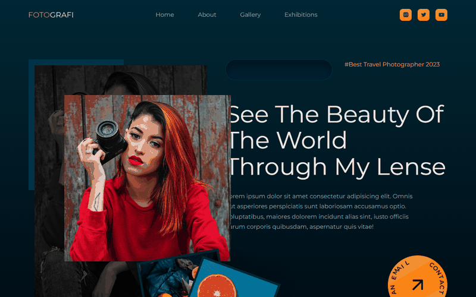

# Photography Portfolio Website

A modern, responsive single-page portfolio for photographers. Built with plain HTML, CSS and JavaScript, it showcases a hero section, an about section, a swipeable photo gallery with a lightbox, an exhibitions grid and a contact form.

The photographer shown on the site, **Diana Ayi**, is a fictional persona used for this design. Her bio, quotes and contact details are placeholder content.

**Live site:** [fmcoskun.github.io/Photography-Portfolio-Website](https://fmcoskun.github.io/Photography-Portfolio-Website/)



## Features

- Hero section with layered image frames and a highlighted tagline
- Responsive navigation with a collapsible mobile menu that closes on link click
- Sticky navigation bar that changes style once the page is scrolled
- Photo gallery powered by [Swiper.js](https://swiperjs.com/) with pagination dots, showing 1, 2 or 3 slides depending on screen width
- Lightbox for gallery photos, with previous/next buttons, arrow-key navigation and Escape to close
- Contact form in a modal window. Submitting it opens the visitor's mail app with the message filled in, so no backend is needed
- Exhibitions grid for displaying events and shows
- Circular rotating-text contact buttons
- Social media links (Instagram, Twitter, YouTube) and a footer with quick navigation
- Lazy-loaded, recompressed images for faster loading
- No build step and no dependencies to install

## Tech Stack

| Layer     | Technology                                                                 |
|-----------|----------------------------------------------------------------------------|
| Markup    | HTML5 (including native `<dialog>` for the lightbox and contact form)      |
| Styling   | CSS3 (custom stylesheet), [Montserrat](https://fonts.google.com/specimen/Montserrat) font |
| Scripting | Vanilla JavaScript                                                         |
| Libraries | [Swiper.js](https://swiperjs.com/) (via unpkg CDN), [Unicons](https://iconscout.com/unicons) icons (via CDN) |
| Hosting   | GitHub Pages, deployed by a GitHub Actions workflow                        |

## Project Structure

```
.
├── index.html                # Page structure and content
├── style.css                 # All styles, including responsive breakpoints
├── main.js                   # Nav, lightbox, contact form, circular button text, Swiper setup
├── images/                   # Photos, logo, background texture and demo GIF
└── .github/workflows/
    └── pages.yml             # Deploys the site to GitHub Pages on every push to main
```

## Getting Started

The site is static, so there is nothing to install.

1. Clone the repository:
   ```bash
   git clone https://github.com/fmcoskun/Photography-Portfolio-Website.git
   ```
2. Open the project folder and launch `index.html` in your browser.

   Or serve it locally, for example with the VS Code *Live Server* extension or:
   ```bash
   npx serve .
   ```

An internet connection is needed on first load, because the fonts, icons and Swiper library are loaded from CDNs.

## Deployment

The site is published with GitHub Pages through the workflow in `.github/workflows/pages.yml`. To set this up on a fork:

1. Go to **Settings → Pages** and set **Source** to **GitHub Actions**.
2. Push to `main`. The *Deploy to GitHub Pages* workflow publishes the site, and the URL appears in the workflow summary.

## Customization

- **Text:** edit the hero, about and exhibitions sections in `index.html`. The current copy is placeholder (Lorem ipsum) text.
- **Photos:** replace the files in `images/` while keeping the same names, or update the `src` attributes in `index.html`. Gallery images are `gallery1.jpg` to `gallery11.jpg`, exhibition images are `e1.jpg` to `e5.jpg`, `ev.jpg` and `eh.jpg`, and the hero and about images are `header.jpg` and `about.jpg`.
- **Contact email:** the address `fmcoskun@gmail.com` is set in several `mailto:` links and in `CONTACT_EMAIL` in `main.js`. Replace it in both places.
- **Social links:** the Instagram, Twitter and YouTube links in the navigation point to the generic domains. Replace them with your profile URLs.
- **Colors:** change the `--color-*` variables at the top of `style.css`.
- **Gallery behaviour:** adjust the `breakpoints`, `spaceBetween` and `slidesPerView` options in `main.js`.

## Browser Support

Modern versions of Chrome, Edge, Firefox and Safari. Internet Explorer is not supported.

## Roadmap

- [x] Lightbox previews for gallery images
- [x] Contact form (opens the visitor's mail app, no backend needed)
- [x] Lazy loading and recompressed image sizes
- [ ] Booking or form service with server-side delivery (requires a backend or third-party service)

## Contributing

Suggestions and improvements are welcome. Fork the repository, create a branch, make your changes and open a pull request.

## License

This project does not currently specify a license. Add one (for example MIT) before reusing the code. The photos in `images/` may not be reused without permission.

## Contact

Built by Fatih Murat Coşkun — [fmcoskun@gmail.com](mailto:fmcoskun@gmail.com)
